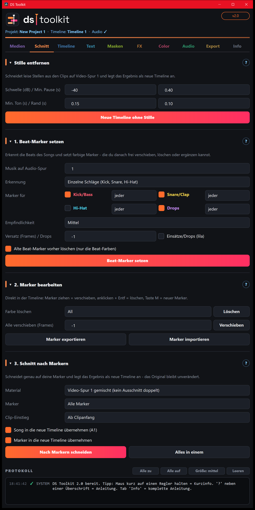
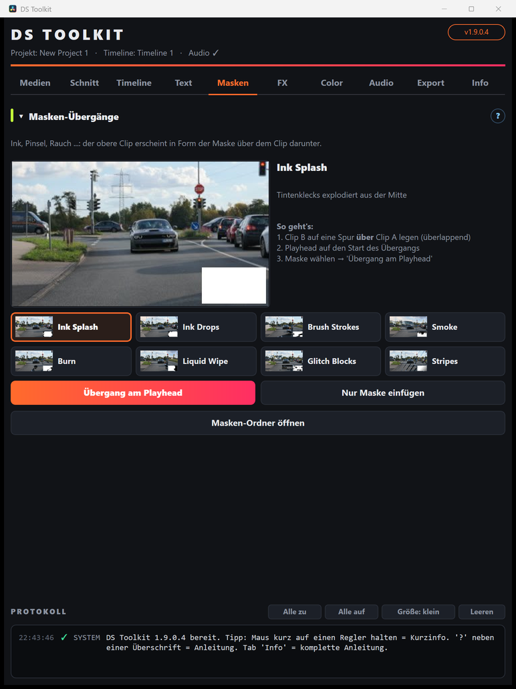

# DS Toolkit für DaVinci Resolve

Ein Werkzeug-Fenster für **DaVinci Resolve Studio**, das wiederkehrende Arbeit abnimmt – vom Sortieren der Medien über den Schnitt auf den Beat bis zum doppelten Export für Instagram und WhatsApp.

**Aktuelle Version: 2.1** · **[🌐 Webseite](https://exorzist26666.github.io/ds-toolkit-public/)** · **[⬇️ Download (Setup.zip)](../../releases/latest/download/DS-Toolkit-Setup-v2.1.zip)** · [Alle Versionen](../../releases)

 

**Was es kann**
- **Medien** sortieren, umbenennen, aufräumen, Proxys per Klick
- **Schnitt:** Stille entfernen · auf den Beat schneiden in 3 Schritten (Beat-Marker setzen, nachbessern, genau auf die Marker schneiden) · **Speedramp** mit 13 Verläufen und eigenem Kurven-Editor
- **Timeline:** Varianten, Statistik
- **Text:** animierte Text+-Titel · **Font Scramble** (Text wechselt animiert durch Schriften)
- **Masken:** **Schnitt-Übergänge** ohne Überlappung (Whip Pan, Zoom, Spin, Glitch …) · Masken-Übergänge (Ink, Rauch, Pinsel …) · **Shape- und Kachel-Reveals** · **Portal** · **Light Leaks & Flashes**
- **FX:** Video-Effekte (Shake, Glitch, Zoom Punch, **Lens Streak** …)
- **Color:** **Look-Bibliothek** (Golden Hour, Teal & Orange, Film, Day-for-Night, Color Pop …) · Look kopieren/einfügen · .drx-Looks und LUTs auf viele Clips · Clip Check (Belichtung)
- **Audio:** Lautheit messen und normalisieren, Ton aufbereiten (Klarheit, Rauschen, Ausgleichen)
- **Export:** Master in voller Qualität + kompakte Datei mit Größen-Limit

---

## 🛠️ Installation

### 1. Herunterladen
**[DS-Toolkit-Setup-v2.1.zip herunterladen](../../releases/latest/download/DS-Toolkit-Setup-v2.1.zip)** – oder unter **[Releases](../../releases/latest)** die Datei **`DS-Toolkit-Setup-v…zip`** wählen (die `.dsupdate`-Datei ist nur für Updates).

### 2. Installieren
1. ZIP entpacken (Rechtsklick › *Alle extrahieren*).
2. **DaVinci Resolve schließen.**
3. Im entpackten Ordner **`INSTALL.bat`** doppelklicken.
   - Windows fragt nach **Administrator-Rechten** → *Ja*.
   - Das Setup installiert alles Nötige selbst und zeigt jeden Schritt mit **OK** an. Am Ende steht „Fertig!“ → Enter drücken.
4. Resolve starten → oben im Menü **Workspace › Scripts › DS Toolkit**.

Fertig – das Toolkit ist sofort einsatzbereit.

### Was das Setup automatisch erledigt
| Baustein | Wozu | Was passiert |
|---|---|---|
| **DS Toolkit** | das Werkzeug-Fenster, Titel, Effekte, Masken, Color-Tools, Anleitung | wird immer installiert bzw. aktualisiert |
| **Python 3** | DaVinci Resolve braucht es, um Python-Skripte wie das Toolkit auszuführen | wird installiert, **falls es fehlt** (über *winget*) |
| **numpy** | Rechenbibliothek für die Audio-Analyse (Beat-Erkennung, Lautheit) | wird installiert, falls es fehlt |
| **ffmpeg** | Audio, Export, Proxys | wird installiert, **falls es fehlt** (über *winget*) |

Bereits vorhandene Programme werden nicht doppelt installiert.

### Voraussetzungen
- **Windows 10 oder 11** mit Internetverbindung beim ersten Setup
- **[DaVinci Resolve Studio](https://www.blackmagicdesign.com/de/products/davinciresolve/studio)** (getestet mit Version 21.1)
- **winget** (App-Installer von Microsoft) – auf aktuellen Windows-Versionen bereits vorhanden. Falls nicht: [App-Installer im Microsoft Store](https://apps.microsoft.com/detail/9NBLGGH4NNS1)

### Falls das Setup etwas nicht automatisch installieren konnte
Das Setup sagt dann genau, was fehlt. Von Hand installieren und danach `INSTALL.bat` noch einmal ausführen:
- **Python 3:** [python.org/downloads](https://www.python.org/downloads/) – beim Installieren **„Add python.exe to PATH“** anhaken
- **ffmpeg:** [gyan.dev/ffmpeg/builds](https://www.gyan.dev/ffmpeg/builds/) – oder in einer Eingabeaufforderung: `winget install Gyan.FFmpeg`

### Wohin wird installiert?
| Was | Ordner |
|---|---|
| Toolkit-Fenster | `%APPDATA%\Blackmagic Design\DaVinci Resolve\Support\Fusion\Scripts\Utility` |
| Titel und Effekte („DS …“) | `%APPDATA%\Blackmagic Design\DaVinci Resolve\Support\Fusion\Templates\Edit` |
| Module, Masken, Vorschauen, Anleitung | `%APPDATA%\DS-Toolkit` |
| Color-Tools (DCTL) | `C:\ProgramData\Blackmagic Design\DaVinci Resolve\Support\LUT\DS Toolkit` |

Deine Einstellungen liegen in `%APPDATA%\DS-Toolkit\settings.json` und bleiben bei Updates erhalten.

---

## 🔄 Updates
Im Toolkit: Tab **Info › Nach Updates suchen** – lädt die neueste Version von hier und installiert sie. Ab 2.1 werden nur noch die geänderten Teile geladen (meist wenige hundert KB). Kein Konto, keine Anmeldung nötig.

Danach das Toolkit-Fenster schließen und neu öffnen (bei neuen Titeln/Effekten Resolve einmal neu starten). Ältere Versionen bleiben unter **[Releases](../../releases)** abrufbar.

## 🗑️ Deinstallieren
`DEINSTALLIEREN.bat` im Setup-Ordner ausführen – entfernt Toolkit, Titel, Effekte und Color-Tools. Python und ffmpeg bleiben installiert, da sie auch von anderen Programmen genutzt werden können.

## ❓ Probleme?
| Problem | Lösung |
|---|---|
| „DS Toolkit“ fehlt unter *Workspace › Scripts* | Resolve komplett schließen und neu starten |
| Im Protokoll steht „Audio-Funktionen deaktiviert“ | Python fehlt oder numpy konnte nicht installiert werden → `INSTALL.bat` erneut ausführen |
| Titel/Effekte fehlen in der Effects Library | Resolve neu starten |
| Fenster zu groß für den Bildschirm | Bereiche per Klick auf die Überschrift einklappen, Protokoll-Größe auf „klein“ stellen |

---

## 📖 Anleitung
**[Zur bebilderten Anleitung →](docs/README.md)** – jede Funktion, Tab für Tab. Im Toolkit selbst: Tab **Info › Anleitung öffnen** (auch offline).

| | | | | |
|---|---|---|---|---|
| [Medien](docs/01-medien.md) | [Schnitt](docs/02-schnitt.md) | [Timeline](docs/03-timeline.md) | [Text](docs/04-text.md) | [Masken](docs/05-masken.md) |
| [Video-FX](docs/06-video-fx.md) | [Color](docs/07-color.md) | [Audio](docs/08-audio.md) | [Export](docs/09-export.md) | [Info & Updates](docs/10-info.md) |

## 📝 Änderungen
Alle Versionen mit Neuerungen, Verbesserungen und Fehlerbehebungen: **[CHANGELOG](CHANGELOG.md)**
