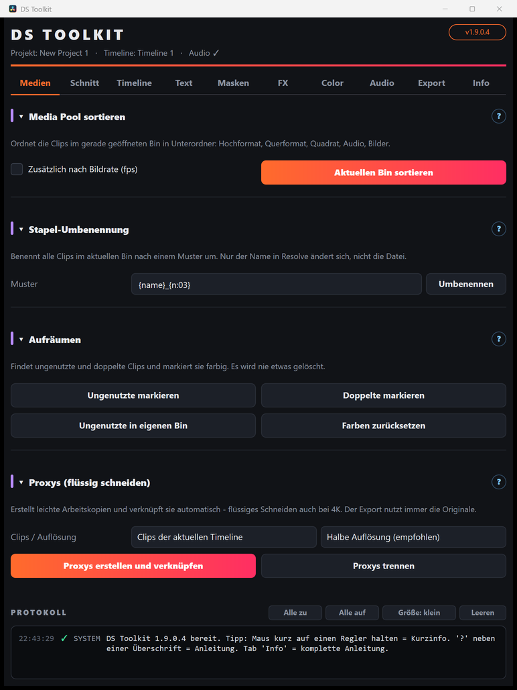

# 01 – Medien

[← Übersicht](README.md) · [Weiter: Schnitt →](02-schnitt.md)

## Media Pool sortieren
Ordnet die Clips im **gerade geöffneten Bin** in einen Unterordner *Sortiert* mit **Hochformat / Querformat / Quadrat / Audio / Bilder**.

1. Im Media Pool den Bin öffnen, der sortiert werden soll.
2. Optional **Zusätzlich nach Bildrate** anhaken → innerhalb der Ordner noch *25 fps*, *50 fps* …
3. **Aktuellen Bin sortieren** klicken.

Es wird nichts gelöscht, die Clips werden nur verschoben.

## Stapel-Umbenennung
Benennt alle Clips im aktuellen Bin nach einem Muster um – **nur der Name in Resolve**, die Datei auf der Festplatte bleibt gleich.

| Platzhalter | Bedeutung |
|---|---|
| `{name}` | bisheriger Name |
| `{n}` / `{n:03}` | laufende Nummer / mit führenden Nullen (001, 002 …) |
| `{datum}` | heutiges Datum |
| `{format}` | Hochformat / Querformat / Quadrat |
| `{fps}` | Bildrate |

Beispiel: `{datum}_{format}_{n:02}` → `2026-10-16_Hochformat_01`

## Aufräumen
Markiert, löscht aber nie etwas.
- **Ungenutzte markieren** – Clips, die in keiner Timeline vorkommen, werden **orange**.
- **Ungenutzte in eigenen Bin** – verschiebt sie zusätzlich in den Bin *Ungenutzt*.
- **Doppelte markieren** – dieselbe Datei mehrfach importiert → **violett**.
- **Farben zurücksetzen** – entfernt die Clipfarben wieder.

## Proxys (flüssig schneiden)
Erstellt leichte Arbeitskopien (DNxHR LB) und verknüpft sie automatisch – flüssiges Schneiden auch bei 4K.

1. **Clips** wählen: Clips der aktuellen Timeline, markierte Clips im Media Pool oder der ganze Bin.
2. **Auflösung**: *Halb* (empfohlen) oder *Viertel* (sehr leicht, z. B. Laptop).
3. **Proxys erstellen und verknüpfen**.

- Die Proxys landen im Ordner **Proxy** neben der Originaldatei.
- Beim Abspielen nutzt Resolve die Proxys, beim **Export immer die Originale**.
- Umschalten in Resolve: *Playback › Proxy Handling › Prefer Proxies / Prefer Camera Originals*.
- **Proxys trennen** löst die Verknüpfung wieder (die Dateien bleiben liegen).

> „Optimized Media“ kann Resolve per Skript nicht erzeugen – Proxys erfüllen denselben Zweck.
