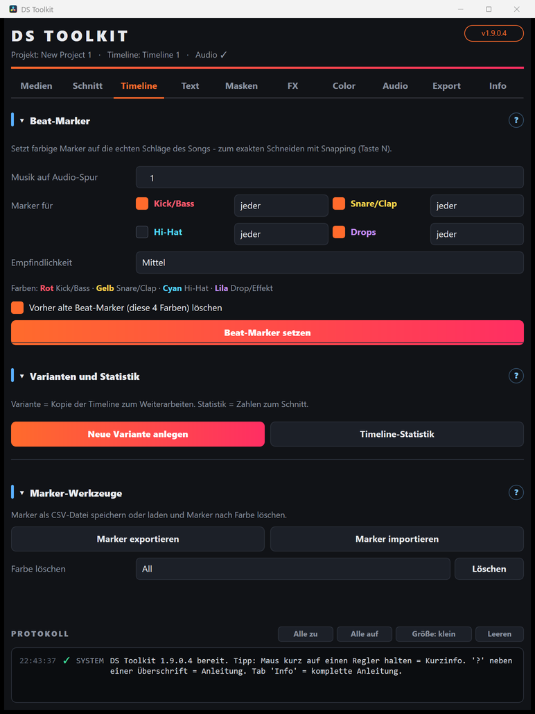

# 03 – Timeline

[← Schnitt](02-schnitt.md) · [Übersicht](README.md) · [Weiter: Text →](04-text.md)

## Beat-Marker
Setzt farbige Marker auf die echten Schläge des Songs – zum exakten Schneiden mit **Snapping (Taste N)**.

| Farbe | Schlag-Art |
|---|---|
| 🟥 Rot | Kick/Bass |
| 🟨 Gelb | Snare/Clap |
| 🟦 Cyan | Hi-Hat |
| 🟪 Lila | Drop/Effekt |

1. **Musik auf Audio-Spur** eintragen.
2. Arten anhaken, daneben *jeder / jeder 2. …* wählen.
3. **Empfindlichkeit** wählen.
4. **Beat-Marker setzen**.

*Vorher alte Beat-Marker löschen* entfernt nur Marker in diesen vier Farben – andere Marker bleiben.

## Varianten und Statistik
- **Neue Variante anlegen** – kopiert die aktuelle Timeline als *Name V2*, *V3* … und öffnet sie. Die bisherige bleibt unangetastet.
- **Timeline-Statistik** – Länge, Anzahl Schnitte, kürzester/längster Clip, Schnitte pro Minute (im Protokoll).

## Marker-Werkzeuge
- **Marker exportieren** – alle Marker als CSV (Excel-tauglich).
- **Marker importieren** – CSV im Format `Sekunde;Name;Farbe;Notiz` einlesen.
- **Farbe löschen** – alle Marker einer Farbe entfernen (*All* = alle).
