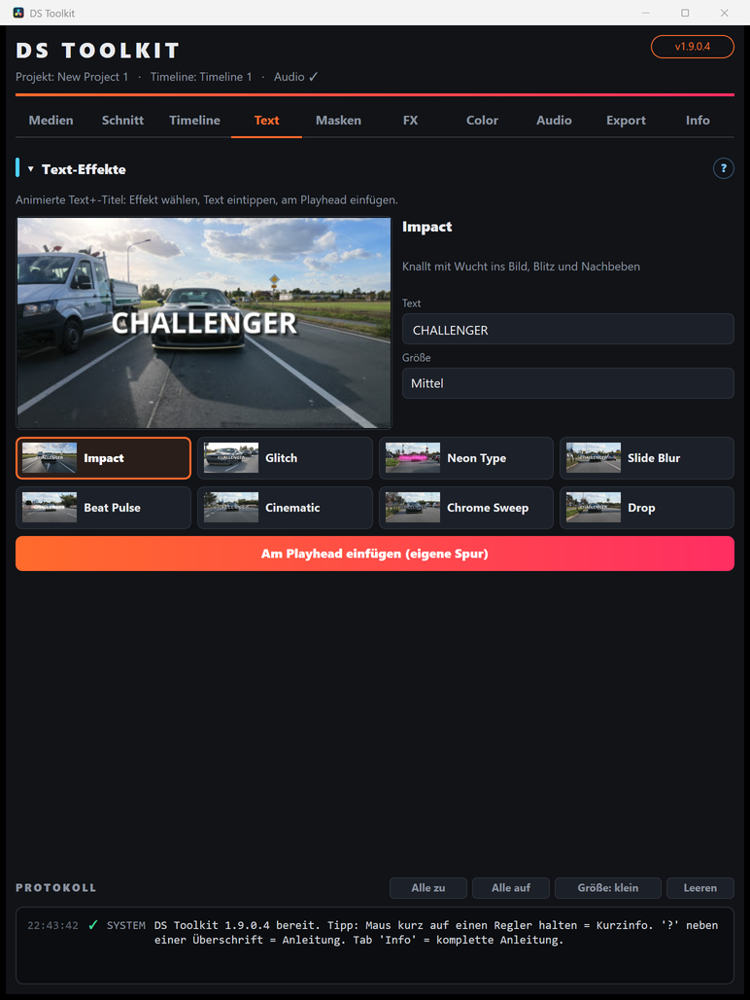

# 04 – Text

[← Timeline](03-timeline.md) · [Übersicht](README.md) · [Weiter: Masken →](05-masken.md)

Animierte **Text+-Titel**: Impact, Glitch, Neon Type, Slide Blur, Beat Pulse, Cinematic, Chrome Sweep, Drop.

1. Effekt anklicken – die Vorschau links zeigt die Animation.
2. **Text** eintippen, **Größe** wählen.
3. Playhead an die gewünschte Stelle setzen.
4. **Am Playhead einfügen** – der Titel kommt auf eine **freie Spur über allem anderen**. Andere Clips werden nicht verschoben.

**Bearbeiten:** Titel in der Timeline anklicken → **Inspector** (Edit-Seite): Text, Schrift, Farbe, Position und die Effekt-Regler (z. B. Wucht, Leuchten, BPM).
**Länge:** Titel in der Timeline kürzer/länger ziehen – Ein- und Ausblenden passen sich an.

Die Titel liegen auch unter *Effects › Titles › Fusion Titles* („DS …“) zum Reinziehen.
