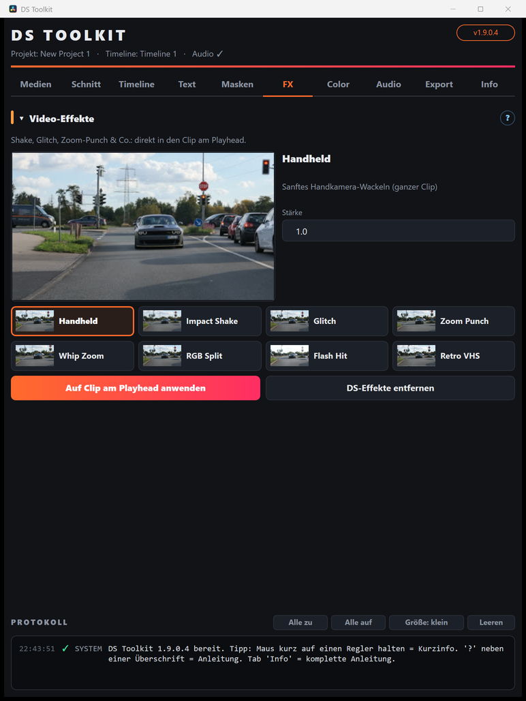

# 06 – Video-FX

[← Masken](05-masken.md) · [Übersicht](README.md) · [Weiter: Color →](07-color.md)

Effekte direkt im Clip: Handheld, Impact Shake, Glitch, Zoom Punch, Whip Zoom, RGB Split, Flash Hit, Retro VHS.

1. Effekt anklicken (Vorschau), **Stärke** einstellen (1,0 = Standard).
2. Playhead auf den Clip stellen. Effekte mit Startpunkt (Impact, Zoom Punch, Whip, Flash) beginnen **genau am Playhead** – ideal auf einen Beat-Marker.
3. **Auf Clip am Playhead anwenden** – der Effekt wird in den obersten Clip unter dem Playhead eingebaut.

- **Bearbeiten:** Clip markieren › Fusion-Seite › Node *DS…Ctl* anklicken › Regler im Inspector.
- Mehrere Effekte pro Clip sind möglich. **DS-Effekte entfernen** nimmt alle wieder heraus.
- Alternativ unter *Effects › Toolbox › Fusion Effects* („DS FX …“) reinziehen – dann sind die Regler direkt im Inspector der Edit-Seite.

## Lens Streak
Anamorphe Lichtstreifen aus allen hellen Stellen (Scheinwerfer, Lampen, Reflexe). Regler: **Intensität**, **Schwelle** (nur das Hellste), **Länge**, **Dicke**, **Winkel**, **Sternfilter** (Kreuz), **Farbe** (Rot/Grün/Blau), **Halo**.
