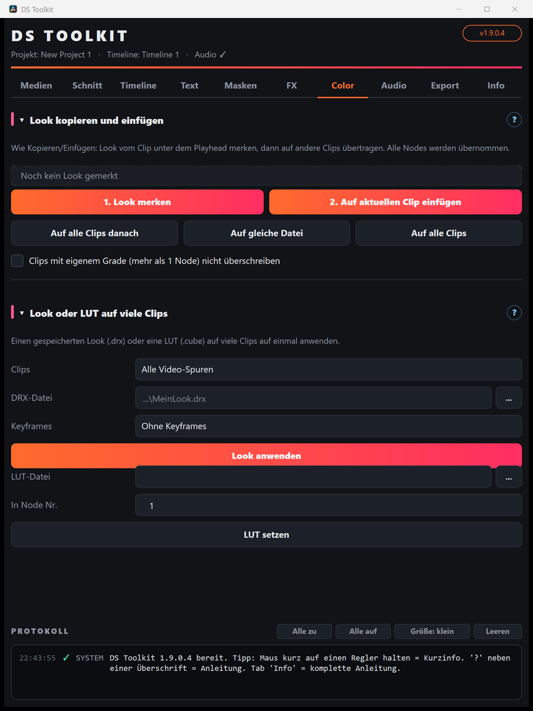

# 07 – Color

[← Video-FX](06-video-fx.md) · [Übersicht](README.md) · [Weiter: Audio →](08-audio.md)

## Look-Bibliothek
Fertige Looks per Klick: **Golden Hour, Golden Sunset, Teal & Orange, Clean Commercial, Clean Architectural, Dramatic Pop, Autumn Moody, Overcast Steel, Studio Low Key, Foggy Night, Neon-Nacht, Film-Emulation, Vintage, Schwarz-Weiß** sowie die Spezial-Looks **Day-for-Night** (Tag wird Nacht), **Color Pop** (nur die gewählte Farbe bleibt, Rest grau), **Atmosphäre** (Dunst, Glühen auf Lichtern) und **Clarity** (mehr Struktur, ohne Halos).

1. Look anklicken – die Vorschau zeigt links vorher, rechts nachher. **Stärke (%)** wählen (100 = voller Look, über 100 = übertrieben).
2. **Gilt für:** alle Clips der Timeline, nur den Clip unter dem Playhead oder die markierten Clips. Bei Color Pop zusätzlich die **Farbe** wählen.
3. **Look anwenden.**

Der Look liegt in einer Farbgruppe **„DS Look: …“** (Post-Clip-Node) **über** deinen Clip-Grades – die bleiben unverändert. Clips, die schon in einer eigenen Farbgruppe sind, bekommen den Look in ihren letzten Node (nur wenn dort keine LUT liegt).

- **Ändern:** einfach einen anderen Look oder eine andere Stärke anwenden – der alte wird ersetzt.
- **Entfernen:** **Looks entfernen** (gleiche Auswahl bei *Gilt für*).
- **Tipp:** Looks wirken am besten auf bereits korrigiertem Material (Belichtung und Weißabgleich passen).

## Look kopieren und einfügen
Wie Kopieren/Einfügen – alle Nodes werden übernommen.
1. Playhead auf den Clip mit dem fertigen Look → **1. Look merken** (das Feld darüber zeigt den gemerkten Clip).
2. Playhead auf einen anderen Clip → **2. Auf aktuellen Clip einfügen**. Beliebig oft wiederholbar.

Schneller:
- **Auf alle Clips danach** – rechts vom Playhead, gleiche Spur
- **Auf gleiche Datei** – alle Ausschnitte derselben Videodatei
- **Auf alle Clips** – alles

Der bisherige Look der Ziel-Clips wird ersetzt. Mit **… nicht überschreiben** bleiben bereits bearbeitete Clips (mehr als 1 Node) verschont.

## Look oder LUT auf viele Clips
**Clips** oben gilt für beide Buttons: alle Video-Spuren, nur V1, nur Clips mit Clipfarbe oder markierte Clips.

- **Look (.drx):** Color-Seite › Rechtsklick ins Bild › *Grab Still*, dann in der Galerie Rechtsklick › *Export* → `.drx`. Datei wählen › **Look anwenden**. *Keyframes*: normalerweise „Ohne Keyframes“.
- **LUT (.cube):** Datei wählen, **In Node Nr.** einstellen › **LUT setzen**. Die LUT muss im Resolve-LUT-Ordner liegen.

## Belichtung prüfen (Clip Check)
**Clip Check an Clips anhängen** setzt eine Belichtungswarnung in den letzten Node der Clips (Auswahl *Clips* oben): **Blau** = Schatten abgesoffen, **Rot** = Lichter ausgebrannt, optional als Zebra-Streifen. Im Node davor die Belichtung regeln, bis am Motiv nichts mehr leuchtet. **Vor dem Export: Clip Check entfernen.**
Clips, deren letzter Node schon eine LUT hat, werden übersprungen – dort einen Node anhängen (Alt+S) und erneut klicken.
