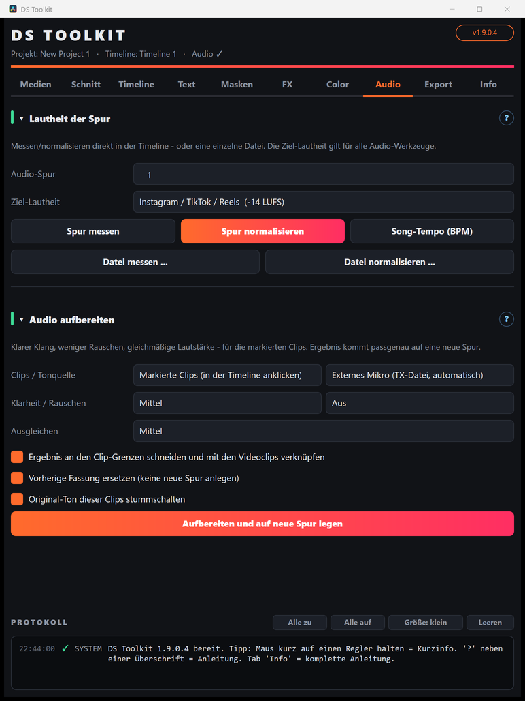

# 08 – Audio

[← Color](07-color.md) · [Übersicht](README.md) · [Weiter: Export →](09-export.md)

## Lautheit der Spur
**LUFS** = gefühlte Lautstärke. Instagram, TikTok und YouTube regeln alles auf ca. **-14 LUFS**.

- **Audio-Spur** und **Ziel-Lautheit** wählen (die Ziel-Lautheit gilt für alle Audio-Werkzeuge).
- **Spur messen** – LUFS, True Peak und wie viel bis zum Ziel fehlt.
- **Spur normalisieren** – alle Clips der Spur auf die Ziel-Lautheit, **direkt in der Timeline** (keine neue Datei, keine neue Timeline – die Clip-Lautstärke im Inspector wird angepasst).
- **Song-Tempo (BPM)** – erkennt das Tempo des Songs.
- **Datei messen / normalisieren** – beliebige Datei ohne Timeline. Die normalisierte Kopie `…_-14LUFS.wav` landet neben dem Original.

True Peak sollte unter **-1 dBTP** liegen, sonst kann es nach dem Upload verzerren.

## Audio aufbereiten
Klarer Klang, weniger Rauschen, gleichmäßige Lautstärke – für die markierten Clips.

1. **Clips**: markierte Clips (anklicken, Strg+Klick) oder alle Clips auf der Audio-Spur oben.
2. **Tonquelle**: *Externes Mikro* sucht die passende DJI-Datei (`TX.._MIC.._Datum_Uhrzeit.wav`) über die Uhrzeit und synchronisiert sie per Tonvergleich – sie muss **nicht** in der Timeline liegen. Oder *Kamera-Ton*.
3. **Klarheit** gegen dumpfen Klang, **Rauschen** gegen Wind/Brummen, **Ausgleichen** gegen Lautstärke-Sprünge.
4. **Aufbereiten und auf neue Spur legen** – Ergebnis auf der Spur *DS Ausgeglichen*, exakt an der richtigen Stelle.

Optionen:
- **An den Clip-Grenzen schneiden** – ein Tonstück pro Videoclip, das sich mitbewegt.
- **Vorherige Fassung ersetzen** – nochmal klicken tauscht das alte Ergebnis aus, statt eine neue Spur anzulegen.
- **Original-Ton stummschalten** – Original-Clips werden deaktiviert, nicht gelöscht (Rechtsklick › Clip aktivieren).
