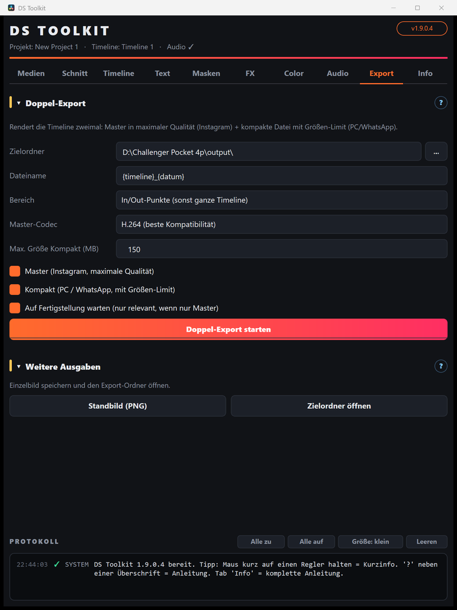

# 09 – Export

[← Audio](08-audio.md) · [Übersicht](README.md) · [Weiter: Info →](10-info.md)

## Doppel-Export
Rendert die Timeline zweimal:
- **Master** – höchste Qualität, volle Auflösung → für **Instagram**.
- **Kompakt** – aus dem Master auf die **MB-Grenze** gerechnet (max. 1080 an der kurzen Seite) → für **PC/WhatsApp**. Trifft die Größe auf 1–2 % genau.

| Feld | Bedeutung |
|---|---|
| **Zielordner** | wohin die Dateien gespeichert werden |
| **Dateiname** | Platzhalter `{timeline}` `{projekt}` `{datum}` `{zeit}` |
| **Bereich** | ganze Timeline, In/Out-Punkte (Tasten **I** und **O**) oder markierte Clips |
| **Master-Codec** | H.264 (läuft überall) oder H.265 (kleiner bei gleicher Qualität) |
| **Max. Größe Kompakt** | z. B. 160 MB |

**Eigene Master-Qualität:** Auf der Deliver-Seite einstellen und als Preset **DS Master** speichern – das Tool nimmt es dann automatisch.

Während Rendern/Umrechnen reagiert das Fenster nicht.

## Weitere Ausgaben
- **Standbild (PNG)** – Bild unter dem Playhead in den Zielordner.
- **Zielordner öffnen** – Export-Ordner im Explorer.
