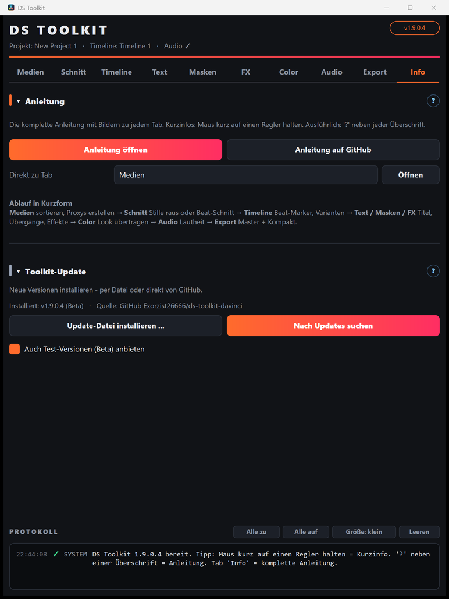

# 10 – Info & Updates

[← Export](09-export.md) · [Übersicht](README.md)

## Anleitung
- **Anleitung öffnen** – diese Anleitung im Browser, auch offline.
- **Anleitung auf GitHub** – diese Anleitung online.
- **Direkt zu Tab** – Anleitung genau beim gewählten Tab öffnen.

## Toolkit-Update
- **Nach Updates suchen** – fragt GitHub nach einer neueren Version und installiert sie. Kein Konto und keine Anmeldung nötig.
- **Update-Datei installieren …** – eine `.dsupdate`-Datei auswählen.
- **Auch Test-Versionen (Beta)** – nur für Tester mit Zugang; ansonsten werden immer die fertigen Versionen (z. B. 2.0) installiert.

Nach dem Update das Toolkit-Fenster schließen und neu öffnen (bei neuen Titeln/Effekten Resolve einmal neu starten). Einstellungen bleiben erhalten, die vorherige Version wird gesichert.

## Versionsschema
- **Fertige Versionen**: kurze Nummer – `1.9`, `2.0`
- **Test-Stände**: vierte Stelle – `1.9.0.1`, `1.9.0.2` … (auf GitHub als *Pre-release*)

## Installation von Grund auf
Siehe **[Installation](../README.md#-installation)** auf der Startseite.
