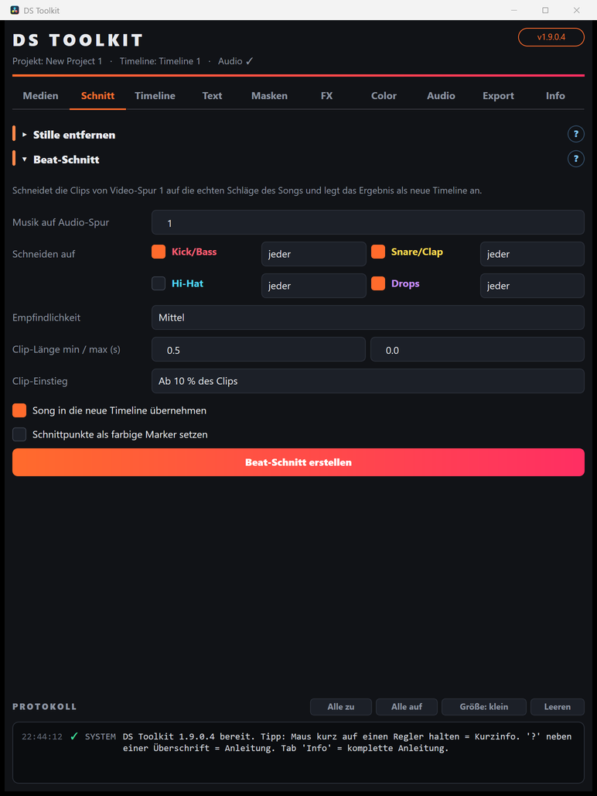

# DS Toolkit – Anleitung

Das DS Toolkit ist ein Werkzeug-Fenster für **DaVinci Resolve Studio**. Es nimmt dir wiederkehrende Arbeit ab: Medien sortieren, auf den Beat schneiden, Titel, Masken-Übergänge und Effekte einbauen, Looks übertragen, Ton angleichen und doppelt exportieren.

**Öffnen:** In Resolve oben im Menü **Workspace › Scripts › DS Toolkit**.

## Die Tabs – in der Reihenfolge eines typischen Projekts

| Tab | Wofür | Anleitung |
|---|---|---|
| **Medien** | Media Pool sortieren, umbenennen, aufräumen, Proxys | [01 – Medien](01-medien.md) |
| **Schnitt** | Stille entfernen, Beat-Schnitt | [02 – Schnitt](02-schnitt.md) |
| **Timeline** | Farbige Beat-Marker, Varianten, Statistik, Marker-Werkzeuge | [03 – Timeline](03-timeline.md) |
| **Text** | Animierte Text+-Titel am Playhead | [04 – Text](04-text.md) |
| **Masken** | Masken-Übergänge (Ink, Rauch, Pinsel …) | [05 – Masken](05-masken.md) |
| **FX** | Video-Effekte (Shake, Glitch, Zoom Punch …) | [06 – Video-FX](06-video-fx.md) |
| **Color** | Look kopieren/einfügen, .drx-Looks, LUTs | [07 – Color](07-color.md) |
| **Audio** | Lautheit messen/normalisieren, Ton aufbereiten | [08 – Audio](08-audio.md) |
| **Export** | Doppel-Export (Master + Kompakt), Standbild | [09 – Export](09-export.md) |
| **Info** | Anleitung öffnen, Updates | [10 – Info & Updates](10-info.md) |

## So bekommst du Hilfe im Tool

- **Kurzinfo:** Maus kurz auf einen Regler oder Button halten.
- **Anleitung pro Bereich:** das **?** rechts neben jeder Überschrift – der Text erscheint unten im Protokoll.
- **Komplette Anleitung:** Tab **Info › Anleitung öffnen** (funktioniert auch offline) oder direkt zu einem Tab springen.

## Fenster, Bereiche und Protokoll

- **Bereiche einklappen:** Klick auf eine Überschrift (▾ / ▸) klappt den Bereich zu oder auf – so passt auch auf kleinen Bildschirmen alles hin. Welche Bereiche zu sind, merkt sich das Toolkit.
- **Alle zu / Alle auf** (über dem Protokoll) klappt alle Bereiche des aktuellen Tabs auf einmal.
- **Größe** schaltet die Protokoll-Höhe um: *klein*, *mittel*, *groß* oder *aus*. Die Werkzeuge bekommen immer den restlichen Platz.
- Beim Öffnen passt sich die Fensterhöhe an deinen Bildschirm an. Der zuletzt geöffnete Tab wird gemerkt.
- Während längerer Aufgaben (Rendern, Proxys, Analyse) reagiert das Fenster kurz nicht – das ist normal.

## Grundregeln

- Das Toolkit **löscht nie Dateien**. Werkzeuge, die stark eingreifen (Stille entfernen, Beat-Schnitt), legen eine **neue Timeline** an – das Original bleibt.
- Viele Werkzeuge arbeiten mit dem **Playhead** (der rote Strich in der Timeline) oder mit **markierten Clips** (anklicken, Strg+Klick für mehrere).
- Nach einem Update: Toolkit-Fenster schließen und neu öffnen. Bei neuen Titeln/Effekten Resolve einmal neu starten.

Versionen und Änderungen: [CHANGELOG](../CHANGELOG.md)
